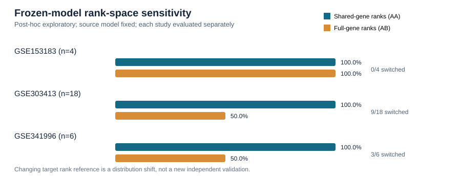

# Project results — exploratory computational audit

> **Not independent validation.** These studies/folds were previously inspected. Labels remain provisional; cross-study gene annotations and expression scales are not fully harmonized. Control/DTP is confounded by treatment duration, dose and culture conditions. No drug-response prediction or causal DTP claim.

## Question and result

**Question:** How stable is a source-trained transcriptomic classifier when the gene-reference space used to compute sample-wise ranks changes?

Source cohort: GSE193258, 24 Control/DTP samples, 19,712 genes, four held-out cell-line folds.
Cross-study target candidates: 28 total across 3 previously inspected studies; 17,963 exact-match gene names in the target-informed shared universe.
Frozen-model target rank change: **12/28 predictions changed**, with identical source-trained classifier and selected features (AA vs AB).

## Baselines (within source study)

| Model | Mean outer LOCO bACC | Pooled DTP recall |
|---|---:|---:|
| DummyMostFrequent | 50.0% | 0.0% |
| LogisticRegression | 100.0% | 100.0% |
| LinearSVC | 100.0% | 100.0% |

## Target-study fixed-model rank-reference audit (stage 10)

AA = source ranked within shared genes; target ranked within shared genes. AB = identical source-trained model, but target ranks computed within its full reported gene universe.

| Study | n | AA bACC | AB bACC | Prediction switches |
|---|---:|---:|---:|---:|
| GSE153183 | 4 | 100.0% | 100.0% | 0 |
| GSE303413 | 18 | 100.0% | 50.0% | 9 |
| GSE341996 | 6 | 100.0% | 50.0% | 3 |

## Negative controls (stage 08)

| Control | Null mean (study-macro bACC) | Exploratory tail fraction |
|---|---:|---:|
| source_label_shuffled_within_cell_line | 48.3% | 0.020 |
| external_gene_correspondence_broken | 49.9% | 0.020 |

Only 49 permutations: tail values are diagnostic, NOT confirmatory p-values.

## Within-study masking feasibility (stage 11)

| Scenario | Baseline bACC | Source-anchor bACC | Baseline switch rate | Anchor switch rate |
|---|---:|---:|---:|---:|
| background_30pct | 100.0% | 100.0% | 0.0% | 0.0% |
| background_50pct | 100.0% | 100.0% | 0.0% | 0.0% |
| all_10pct | 100.0% | 100.0% | 0.0% | 0.0% |
| all_25pct | 100.0% | 100.0% | 0.0% | 0.0% |

**Stage-11 predeclared exploratory success gate passed:** False. No demonstrated improvement for the proposed anchor panel on this source-only missing-gene simulation.

## Interpretation and scope

1. Control/DTP source separation is easy in this setup; a perfect score does not establish biological specificity.
2. Target rank-reference choice alone changes predictions while model weights are fixed. This is a descriptive robustness failure under a representation shift.
3. The within-source artificial gene-deletion experiment was non-discriminating: both candidates remained perfect. Do not claim anchor superiority.
4. External target studies were inspected during development; test-conditioned common gene identifiers were used. A held-out independent study is still required for a confirmatory generalization claim.
5. Source label biology, exact gene annotation, treatment-dose/duration confounding and per-study measurement scales require review. The GSE303413 recorded dose discrepancy remains unresolved.
6. Statistical uncertainty is high: studies have 4, 18 and 6 evaluated samples respectively; no inference should be made from these results alone.

## Reproducibility

The CSV contains the machine-readable aggregate metrics; the JSON manifest contains SHA-256 hashes of each underlying report. All values were **read, not re-trained** by stage 12.

**Status: exploratory computational case study; no independently validated new algorithm.**
